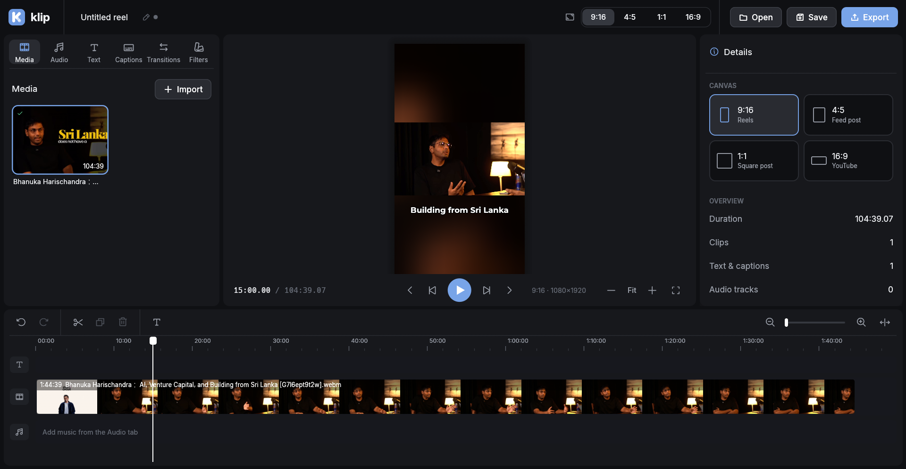

<div align="center">

# klip

**The CapCut alternative Linux never had.**<br>
Edit Reels, Shorts and TikToks. Fast, native, free.

</div>

<p align="center">
  
  
  
  
  
</p>

> ⚠️ **Early development**<br>
> Klip is still in early development. Things may break or change between updates, and project files from older versions might not open in newer ones.



## Download

Grab the latest build from the [releases page](https://github.com/chamals3n4/klip/releases/latest):

| File | For | Install |
|---|---|---|
| [`klip-x86_64.AppImage`](https://github.com/chamals3n4/klip/releases/latest/download/klip-x86_64.AppImage) | Any distro | `chmod +x klip-x86_64.AppImage && ./klip-x86_64.AppImage` |
| [`klip_amd64.deb`](https://github.com/chamals3n4/klip/releases/latest/download/klip_amd64.deb) | Ubuntu, Debian, Mint | `sudo apt install ./klip_amd64.deb` |
| [`klip.x86_64.rpm`](https://github.com/chamals3n4/klip/releases/latest/download/klip.x86_64.rpm) | Fedora, openSUSE | `sudo dnf install ./klip.x86_64.rpm` |

The .deb and .rpm pull in FFmpeg for you. The AppImage needs FFmpeg installed on your system.

## Build from source

**1. Install FFmpeg**

```bash
# Fedora (enable RPM Fusion for full codec support)
sudo dnf install ffmpeg

# Ubuntu / Debian
sudo apt install ffmpeg
```

You'll also need Rust from [rustup.rs](https://rustup.rs).

**2. Build and run**

```bash
git clone https://github.com/chamals3n4/klip.git
cd klip
cargo run --release
```

You can also open files straight away: `klip clip.mp4 song.mp3 subs.srt`

## Shortcuts

<table>
<tr>
<td><kbd>Space</kbd> Play / pause</td>
<td><kbd>S</kbd> Split</td>
<td><kbd>Del</kbd> Delete</td>
</tr>
<tr>
<td><kbd>← →</kbd> Step a frame</td>
<td><kbd>Ctrl</kbd>+<kbd>D</kbd> Duplicate</td>
<td><kbd>F</kbd> Full screen</td>
</tr>
<tr>
<td><kbd>Ctrl</kbd>+<kbd>Z</kbd> Undo</td>
<td><kbd>Ctrl</kbd>+<kbd>S</kbd> Save</td>
<td><kbd>Ctrl</kbd>+<kbd>E</kbd> Export</td>
</tr>
</table>

## Roadmap

- [x] Timeline editing, text, captions, music, export
- [x] Transitions, fades, filters and free transform (move, scale, rotate)
- [x] Project manager to browse, open and organise your projects
- [x] Audio fade in / out
- [ ] Auto captions (on-device Whisper)
- [x] Speed control
- [ ] Templates for common Reel formats

## How it works

Every edit you make updates a simple project description: which clips are on the timeline, where they're trimmed, and what text and music sit on top.

Klip hands that description to FFmpeg in two ways. While you edit, FFmpeg decodes frames for the live preview. When you export, it renders the final MP4. Because both use the same engine, the exported video matches what you saw while editing.

## License

[MIT](LICENSE). The bundled Inter font is under the SIL Open Font License (`assets/fonts/Inter-LICENSE.txt`).
